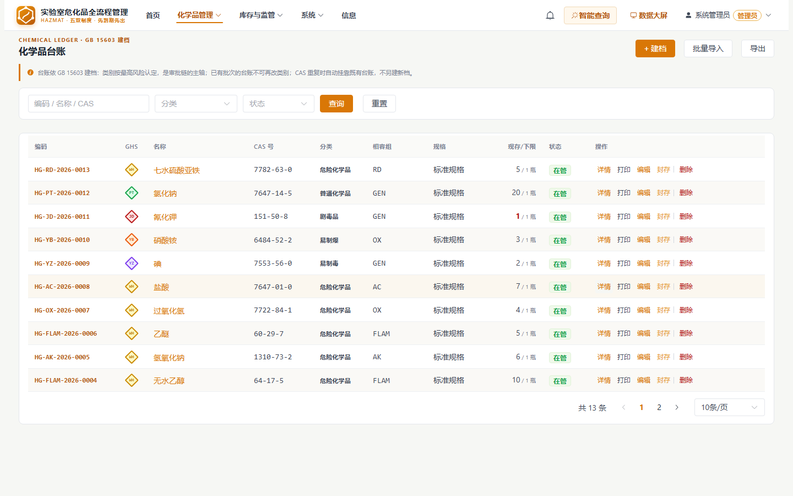
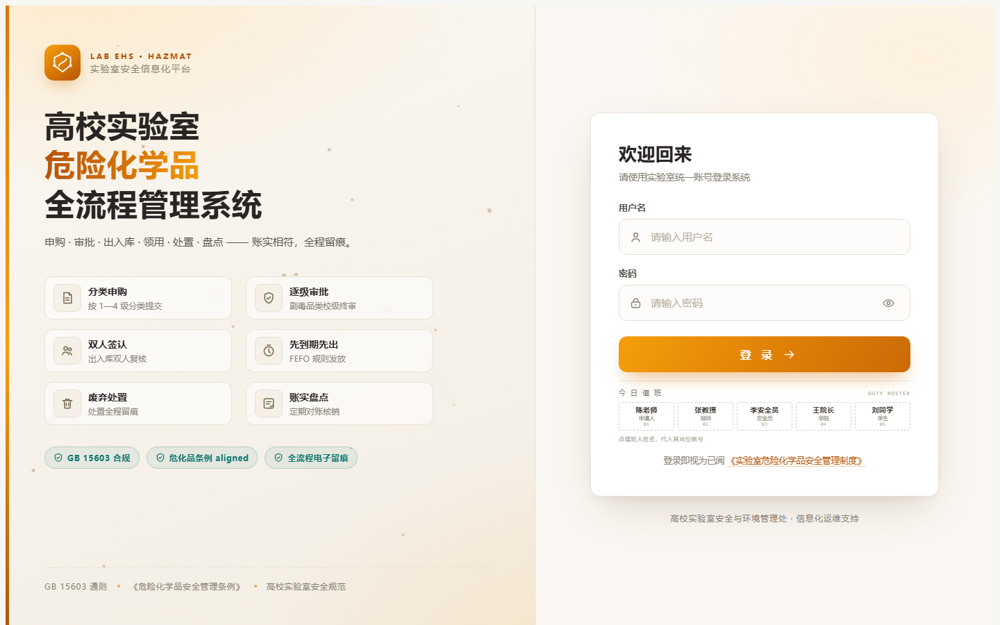
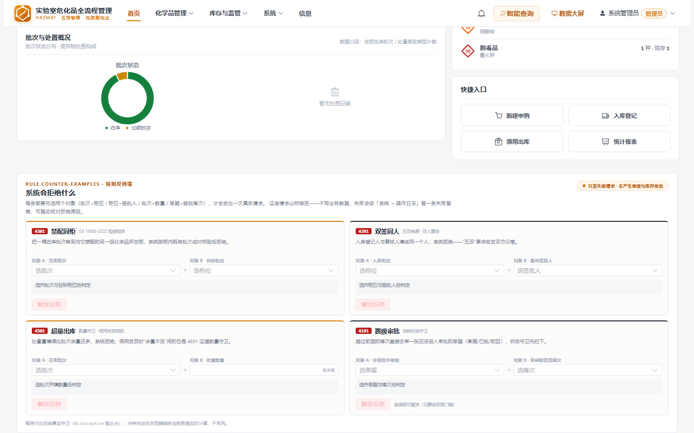
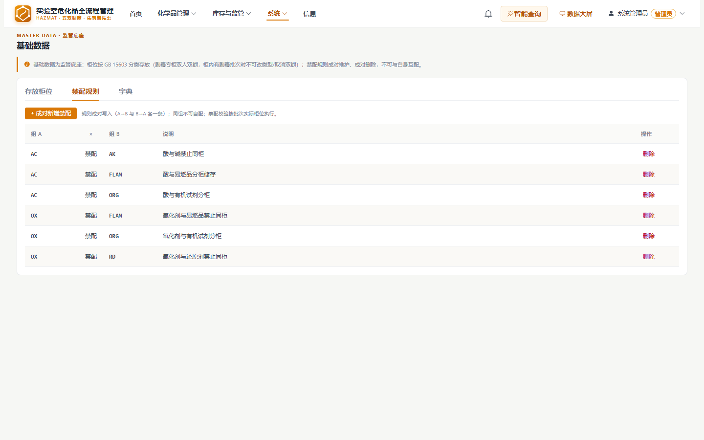
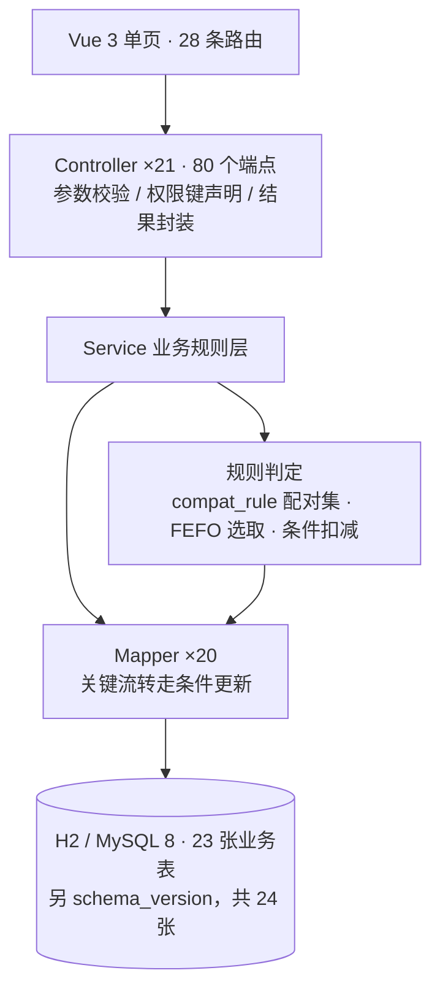

# hazmat-lims · 实验室危险化学品管理系统

- **单据闭环**：申购 → 多级审批 → 入库双签 → 领用双签出库 → 余量归还 → 废弃销账 → 盘点调账，每一步都有状态守卫
- **规则在后端判定**：禁配冲突、剧毒单次上限、超领、超量归还、盘亏调账都在服务层拒绝并给出业务码，不靠操作人自觉
- **库存可对账**：FEFO 先到期先出、按批次条件扣减、Σ批次余量 ≡ 台账在库量；操作日志记录每次成功/失败与所属业务模块

> 演示项目：内置演示账号与默认口令，请勿直接部署到公网。对外提供访问前先按「部署」一节改掉口令与令牌密钥。



## 目录

- [快速开始](#快速开始)（一键 / 手动 / 界面）
- [项目结构](#项目结构)
- [功能清单](#功能清单)
- [架构](#架构)
- [三个不好糊弄的地方](#三个不好糊弄的地方)
- [部署](#部署)（环境变量 / 容器）
- [测试](#测试)（单测 / 前端构建 / E2E）
- [实现约定](#实现约定)
- [技术栈](#技术栈)
- [范围说明](#范围说明)
- [许可](#许可)

## 快速开始

环境：JDK 17+、Maven 3.9+、Node 18+（前端构建）；数据库用自带 H2 或自备 MySQL 8.0.x（本轮实测 8.0.45）。不需要任何私有仓库。

前端是 Vue 单页应用，页面必须先构建出来并放进后端的 `classpath:/static`，jar 里才有界面。
只执行 `mvn package` 就启动，`GET /` 会返回 404「前端未构建，请先 npm run build」——后端单测和纯 API 调试不需要前端，这是刻意保留的分支。

### 一键（推荐）

```bash
# 仓库根目录。Windows 用 Git Bash：bash start.sh
./start.sh
```

脚本依次做：构建前端 → 把 `web/dist` 拷进 `server/src/main/resources/static` → `mvn package` → 后台启动并轮询 `/health`。
就绪后打开 `http://localhost:8080`，演示账号 `admin / admin123`。

### 手动分步

```bash
# 1) 前端构建（首次需联网装依赖）
cd web && npm ci && npm run build

# 2) 产物交给后端同源提供
mkdir -p ../server/src/main/resources/static
cp -r dist/. ../server/src/main/resources/static/

# 3) 启动后端（首次启动自动建表并注入演示数据）
cd ../server && mvn -q spring-boot:run      # 端口 8080
curl http://localhost:8080/health
```

打开 `http://localhost:8080`。演示账号：`admin / admin123`；`zhang`（导师）、`li`（安全员）、
`wang`（学院）、`zhao`（校级）、`chen` / `liu`（申请人）默认口令 `123456`。
两组口令分别用 `APP_SEED_ADMIN_PASSWORD`、`APP_SEED_DEMO_PASSWORD` 覆盖（只在首次建库时生效）。
数据落在 `server/data/` 下的 H2 文件库。

跳过前端只跑 API 也可以：`cd server && mvn -q spring-boot:run`，此时 API 与 `/health` 正常，`GET /` 返回 404 提示先构建前端。

### 界面

| 登录 | 看板 |
|---|---|
|  |  |

| 禁配墙（看板下半部分） | 化学品台账 |
|---|---|
|  |  |

| 基础数据 · 禁配规则 | 监管大屏 |
|---|---|
|  |  |

截图由 `e2e/scripts/screenshots.js` 生成（Playwright，1440×900）；后端起在 8080 后执行
`cd e2e && BASE_URL=http://localhost:8080 node scripts/screenshots.js`。

**实测（2026-11-28，Windows 11 / Git Bash / JDK 21.0.8 / Maven 3.9.9 / Node 22.20.0）**：

```text
$ ./start.sh
[start] 已就绪（12s）：{"status":"UP","version":"1.0.0","time":"2026-11-28 16:33:28",
 "checks":{"db":"up","regs":"up(128)","ai":"degraded(no-key)"}}
$ curl -I http://localhost:8080/
HTTP/1.1 200
Content-Type: text/html
```

`db=up` 表示 H2 建表 + 种子数据就绪；`regs=up(128)` 是加载到的法规条目数；
`ai=degraded(no-key)` 是**预期状态**——没配 `DEEPSEEK_API_KEY` 时 AI 层自动降级，
不影响主流程。想从头再来一遍：停服后删掉 `server/data/` 再启动。

## 项目结构

```text
hazmat-lims/
├── server/                      Spring Boot 后端（Java 17）
│   └── src/main/java/…/         web/ 控制器 21 个 · service/ 业务规则 · mapper/ 数据访问 · security/ 令牌与拦截
│       src/main/resources/      mapper/*.xml · db/migration/*.sql（V1 基线 + V2 站内信）
│       src/test/java/…/         22 个测试类、216 条单测（H2 内存库 + mock，试跑 -o 离线可过）
├── web/                         Vue 3 前端（Vite）
│   └── src/views/               页面：台账/申购/入库/领用/废弃/盘点/大屏/打印/系统管理
│       src/layouts/             顶栏布局：导航渲染自 /auth/me 的 menus 树
│       src/store/               会话仓库（token / roles / perms / menus）
│       src/api/                 axios 封装：401 自动清会话回登录页
├── e2e/                         Playwright 端到端
│   ├── tests/                   accept（A01-A16）/ extra / review（R01-R07）/ ai 共 29 条
│   └── scripts/screenshots.js   截图生成脚本
├── docs/screenshots/            README 展示用截图
├── scripts/                     本地辅助脚本
├── tools/convert_schema.py      H2 建表脚本 → MySQL 8 语法转换
├── start.sh                     一键：构建前端 → 拷静态资源 → 打包 → 启动并轮询 /health
├── Dockerfile                   多阶段自包含镜像（Node 构建 + Maven 打包 + JRE 运行）
└── .github/workflows/ci.yml     三个 job：后端单测 / 前端构建 / Playwright E2E
```

## 功能清单

| 模块 | 能力 | 主要端点 |
|---|---|---|
| 化学品台账 | 档案、相容组（主 + 次）、GHS 标识、效期预警天数、安全库存、封存/解封 | `/chem/info` |
| 批次 | 效期与余量、柜位、移柜、过期标记 | `/chem/batch` |
| 申购 | 草稿 → 按分类走 1~4 级审批 → 已批；驳回、作废、审批流转留痕 | `/chem/purchase` |
| 入库 | 一步签收或双签复核（登记人不能自任第二签） | `/chem/stockin` |
| 领用与归还 | 导师签 → 复核双签 → FEFO 出库；余量归还回原批、改派、核销 | `/chem/req` |
| 废弃处置 | 废液处置去向、审批销账 | `/chem/waste` |
| 盘点 | `finish` 只快照账面差异，`adjust` 才按差值调账（每条差异只能调一次） | `/chem/check` |
| 待办中心 | 待审申购、待签领用、归还确认三个入口 | `/chem/todo` |
| 基础数据 / 系统 | 字典、用户/角色/菜单、操作日志、站内信 | `/system/*`、`/biz/notice` |
| 智能查询 | 缓存回放 + 台账检索 + 法规条文检索；无密钥时自动降级，不编造数据 | `/ai/ask` |

## 架构



关键流转（借出 / 归还 / 报废 / 销账）的基本形状：Service 先查规则表做判定，判定通过后转成一条带
`WHERE 状态=期望` 的 UPDATE，用受影响行数当"成功/被并发抢先"的判据，最后在同一个事务里同时改批次余量与台账在库量。
基础信息修改（`chem_info.update` / `updateStatus`）不套这个形状：先读后写、`WHERE id=?` 直改，
面向单用户维护档案的场景，不是并发防护。

## 三个不好糊弄的地方

### 一、禁配矩阵：按排序键匹配，自反必须禁止

`compat_rule(group_a, group_b)` 按有序对存储。判冲突时把柜内在库批次的相容组与规则集两两配对，
配对键由 `CompatService.pairKey` 生成——先把两端字符串排序再拼接。顺序在键里被抹平，
因此一条规则覆盖两个查询方向：只存 `(酸, 碱)` 一行，按 `(碱, 酸)` 查同样命中。
新增/删除仍成对写两行（两条写操作同事务，不会出现半对规则），目的是让规则表每对完整、
列表展示与人工维护口径一致；防重由 `UNIQUE(group_a, group_b)` 兜底。

自反（`group_a = group_b`）在服务层直接拒绝。同组化学品同柜是常态，若允许自反规则，等于一条数据就能
让某类化学品全场无处可放，而且这种"规则把自己禁掉"的故障极难从日志里看出来。
`UNIQUE(group_a, group_b)` 只负责防重，禁自反是业务判定，两者分工不能混。

判定口径是**批次实际柜位**，不是台账期望柜位：一条化学品的各批次可能分散在多柜，只有真正在柜内的批次才参与配对。
另有一种化学品带两个相容组（主组 + 次组）的情形，任一命中即算冲突，避免"换个组就绕过去"。

### 二、FEFO：条件扣减，扣空了就换批

出库不是"选一批扣掉"，而是按效期先后排队逐批扣：

1. 先取候选批次（在库、有余量、且未过期），按效期升序、批号次序排；
2. 用 `SUM(qty_left)` 做一次预检，总量不够直接拒绝，不做任何扣减；
3. 逐批执行 `UPDATE ... SET qty_left = qty_left - ? WHERE id = ? AND status = 0 AND qty_left >= ?`；
4. **受影响行数为 0 就 `continue` 换下一批**——这行没扣成（被别人抢先、或状态已变），本次需求量原样带到下一批；
5. 全部批次扣完仍有缺口则回滚整体；台账侧只扣一次总量，不按批扣。

第 4 步是这套写法与"先查再改"的分水岭。先查再改在并发下会写出负余量或丢扣减；
条件更新把"这一批还够不够"交给数据库判定，`affected=0` 不是异常，而是正常的换批信号。
单据状态 `1→2` 放在所有扣减与明细落库之后才推进，保证"出库中"的单据不可能只有半张明细。

候选集的效期条件是必须的：过期批次默认仍是 `status=0`（没有任务把它改成 3），
只按状态与余量筛选，效期最早的过期批次会排在队首优先发出去。SQL 侧以
`(expiry_date IS NULL OR expiry_date >= CURDATE())` 排除过期批次——没有失效日期的批次按"不设期限"处理，
照常参与出库。

### 三、账物守恒：Σ批次余量 ≡ 台账在库量

不变量只有一句：某化学品台账的 `stock_qty`（在库量）恒等于它所有 **在库批次**（`status=0`）的 `qty_left` 之和。
维护它的方式不是定期对账，而是让**每一条改库存的路径都同时改两边、都在同一事务里、都带条件**：
入库加批次并加台账、出库扣批次并扣台账、盘盈盘亏按差值同向修正两边、废弃处置扣台账；
过期封存的批次按口径已退出 Σ（不计入在库量），销账时只把余量清零，不再动台账。
任何一边的条件更新没命中，整个事务回滚，账面不会留下只改了半边的中间态。

**现状标注（两条缺口）**：

- 过期封存（批次 `status=3`）在默认流程下不可达。`ChemInfoMapper.updateBatchStatus` 没有调用点，
  效期调度（`HazmatScheduler.scanExpiry`）只推站内信提醒，不迁移状态；要把批次置为 3 只能人工改库。
  因此依赖 `status==3` 的 type=3 废弃处置单（`WasteService` 硬校验，不满足返回 4502）在默认流程下
  永远打不通。补入口时要一并定"封存即扣台账"的口径——现在代码里没有这个扣减动作。
- 这条不变量是**设计约定 + 守卫**，不是可检测的断言。`sumBatchLeft` 只在两处用到：改类别前的存量判断
  与删除前的存量判断（`ChemInfoService.update` / `remove`），全仓没有任何地方把 Σ 批次余量与 `stock_qty`
  做比较，也没有周期性校验点。某条路径漏写不会报错，只会账实不符；要核对得手工跑 SQL 或另加只读校验接口。

盘点因此必须分两段：`finish` 只把当时的批次余量快照成账面数、记录实盘数与差值，**一行库存都不动**；
`adjust` 才按差值做增量修正（正加负减，绝不"直接设成实盘数"），且每条差异只能调一次。
调账前还要确认批次仍在库——结单到调账之间批次可能已被封存（人工置 `status=3` 或演示种子预置），此时对不在 Σ 里的批次做加减会直接破坏不变量，
所以这类差异行会被标注为需要重盘并拒绝调账。

## 部署

演示口令与开发默认值都是可覆盖的配置项，不写死在代码里。生产部署按需设置：

| 环境变量 | 作用 | 未设置时的行为 |
| --- | --- | --- |
| `APP_SEED_ADMIN_PASSWORD` | 种子管理员 `admin` 的初始口令 | 回落到 `admin/admin123`，启动日志打印一行警告 |
| `APP_SEED_DEMO_PASSWORD` | 其余 6 个演示账号（导师/安全员/学院/校级/申请人 ×2）的初始口令 | 回落到 `123456` |
| `APP_TOKEN_SECRET` | 登录令牌的签名密钥 | 生成本次运行的临时随机密钥，重启后已签发令牌失效 |
| `APP_SECURITY_TRUST_PROXY` | 是否信任反向代理写入的 `X-Forwarded-For` | `false`：只认 TCP 对端地址（`getRemoteAddr()`） |
| `APP_SECURITY_TRUSTED_PROXIES` | 受信反代地址清单（精确 IP / IPv4 CIDR / `10.0.0.*`） | 空：即使开了 `trust-proxy` 也不读 XFF |
| `DEEPSEEK_API_KEY` | AI 问答的模型凭据 | `/health` 报 `ai=degraded(no-key)`，问答走规则检索 |

口令与密钥都不落盘、不回显：启动日志只说明取值来源，不打印本体。前两项建议在任何对外可达的部署里显式设置；
`DEEPSEEK_API_KEY` 可选，AI 是增强路径，未配置时业务主流程不受影响。
`APP_SECURITY_TRUST_PROXY` 只在前面确实有反向代理时开启，并把反代地址写进
`APP_SECURITY_TRUSTED_PROXIES`；否则伪造 `X-Forwarded-For` 就能绕开登录锁定与接口限流。

### 容器

`Dockerfile` 是多阶段自包含构建：Node 阶段 `npm ci && npm run build`，Maven 阶段把 `dist` 拷进
`classpath:/static` 后打出单 jar，运行时镜像只带 JRE 与 jar。干净 clone 直接构建即可，不需要本机预装依赖：

```bash
docker build -t hazmat-management:1.0.0 .
docker run -d --name hazmat -p 8080:8080 -v hazmat-data:/app/data hazmat-management:1.0.0
```

`GET /health` 已配置为镜像健康检查；改用 MySQL 时传 `-e SPRING_PROFILES_ACTIVE=mysql` 与 `MYSQL_*`（见「MySQL 8」一节）。

### MySQL 8

实测版本 8.0.45（Community Server）。库名、口令、端口一律走环境变量，命令里不出现真实口令。
下面四条都在**仓库根目录**执行（注意 `cd server` 只在最后一步）。

```bash
# 1) 建库。不写 COLLATE 就用 MySQL 8 默认的 utf8mb4_0900_ai_ci，实测可用
mysql -uroot -p --default-character-set=utf8mb4 \
  -e "CREATE DATABASE hazmat DEFAULT CHARACTER SET utf8mb4"

# 2) 生成 MySQL 版建表脚本：MySQL 8 不认 CREATE INDEX IF NOT EXISTS
python tools/convert_schema.py          # 产出仓库根目录下的 schema-mysql.sql（UTF-8 无 BOM）

# 3) 导入（schema.sql 基线：22 张表 / 44 个索引对象 = 24 条显式 CREATE INDEX + 20 个表内主键，exit 0）
#    启动后 V2 再补 notify_message 与 schema_version，全库共 24 张表（23 张业务表 + schema_version）
mysql -uroot -p --default-character-set=utf8mb4 hazmat < schema-mysql.sql

# 4) 启动。建表已手工完成，初始化模式设为 never
export MYSQL_HOST=127.0.0.1 MYSQL_PORT=3306 MYSQL_DATABASE=hazmat \
       MYSQL_USERNAME=hazmat MYSQL_PASSWORD='***' MYSQL_INIT_MODE=never
cd server && mvn -q spring-boot:run -Dspring-boot.run.profiles=mysql
```

跳过第 2 步直接导入，第一条 `CREATE UNIQUE INDEX IF NOT EXISTS` 就报
`ERROR 1064 (42000)`；mysql 客户端在批处理模式下随即中止，22 张业务表里只建成 1 张。
`MYSQL_INIT_MODE` 留在默认 `always` 时，应用启动会在同一条语句上失败
（`Failed to execute SQL script statement #2 of file [...schema.sql]`），所以必须显式设 `never`。
`spring.sql.init.mode` 的默认值是 `always`：每次启动执行 `schema.sql`（语句全部带 `IF NOT EXISTS`，幂等）。
MySQL 生产库若已由 DBA 建好，设 `never` 跳过重复执行，顺带避开 MySQL 不认的那几条建索引语句。

转换只动索引语句，`CREATE TABLE IF NOT EXISTS` 与数据类型都原样保留；脚本用 UTF-8 无 BOM 写出，
Windows 下不需要另装 `sed` 或手工改编码。

**MySQL 分支实测（2026-11-27，Windows / JDK 21.0.8 / Maven 3.9.9）**：

```text
MySQL 8.0.45 免安装实例：mysqld --initialize-insecure（root 空口令），独立 datadir
端口 3307（本机 3306 已被既有实例占用），character-set-server=utf8mb4，default-time-zone=+08:00
库 hazmat（默认 utf8mb4_0900_ai_ci）

原始 schema.sql 导入 → exit 1
  ERROR 1064 (42000) at line 32: ... near 'IF NOT EXISTS uk_chem_code ON chem_info(code)'
  （在第一条索引处中止，只建成 1 张表）
转换后导入 → exit 0，22 张表 / 44 个索引对象（24 条显式 CREATE INDEX + 20 个表内主键）
应用启动后 V2 建 notify_message 与 schema_version → 共 24 张表（23 张业务表 + schema_version）
MYSQL_INIT_MODE=always → 启动失败（statement #2 同一条索引语句），exit 1
MYSQL_INIT_MODE=never  → GET /health 200
  {"status":"UP","version":"1.0.0","checks":{"db":"up","regs":"up(128)","ai":"degraded(no-key)"}}
```

管理员登录 `code:0`；`/chem/stats/dashboard`、`/chem/stats/ledger`、`/chem/info/list`
等只读接口全部 `code:0`；申购单创建 → 提交 → 审批中写链路成功；中文按 UTF-8 存取一致
（`HEX('无水乙醇')` = `E697A0E6B0B4E4B999E98687`，与 Java 写入值逐字节相同）；
`mvn -q test` 在 MySQL profile 改动后仍是 216 条全过。

**验证范围**：单实例 MySQL 8.0.x（本轮为 8.0.45 免安装实例，独立 datadir、独立端口）。
5.7、DBA 托管实例、主从复制、跨时区部署不在本仓库的验证范围内，接入前先在自有环境把上面四步与 `/health` 自检跑一遍。

## 测试

2026-11-28 在本机实测（Windows 11 / JDK 21.0.8 / Maven 3.9.9 / Node 22.20.0）：

| 项 | 命令 | 实测结果 |
|---|---|---|
| 后端单测 | `cd server && mvn -q test` | **Tests run: 216, Failures: 0, Errors: 0, Skipped: 0**（22 个测试类，`-o` 离线可跑） |
| 前端依赖 | `cd web && npm ci` | `added 126 packages in 36s`（首次需联网） |
| 前端构建 | `cd web && npm run build` | vite 6.4.3，`built in 14.13 s`；入口 `index-*.js` **48.2 kB**（gzip 18.8 kB），重型库各自成 chunk 按需加载：echarts 1100 kB、element-plus 801 kB、three 549 kB、xlsx 277 kB、vue 107 kB、vendor 179 kB；另有页面级 chunk 24 个（登录页不加载图表与 3D） |
| E2E | `cd e2e && npx playwright test` | **29 passed（1.2 min，单 worker 串行）** |
| CI | `.github/workflows/ci.yml` | 后端单测 + 前端构建 + Playwright E2E 三个 job |

E2E 的前置是三件事：① 后端在 8080 上同时提供前端页面与 API；② `web/dist/` 已构建；③ Playwright 浏览器已安装。
任缺一件，失败信息都容易误读成业务失败——尤其缺浏览器时报 `Executable doesn't exist at ...chromium_headless_shell`。
先把 `dist/` 交给后端同源提供，再起服务：

```bash
cd web && npm run build

# 方式 A：拷进静态目录后重新打包（上面的标准路径）
mkdir -p ../server/src/main/resources/static && cp -r dist/. ../server/src/main/resources/static/

# 方式 B：不重新打包，启动时把静态目录指过去
cd ../server && java -jar target/hazmat-management-1.0.0.jar --server.port=8080 \
  --spring.web.resources.static-locations=file:../web/dist/ \
  --spring.datasource.url='jdbc:h2:file:./data/e2e-hazmat;MODE=MySQL;CASE_INSENSITIVE_IDENTIFIERS=TRUE'

# 首次需要浏览器二进制（约 124 MB）；缺了 29 条会全部报 Executable doesn't exist
cd ../e2e && npm ci && npx playwright install chromium
BASE_URL=http://localhost:8080 npx playwright test
```

E2E 固定单 worker 串行（`playwright.config.js` 的 `workers: 1`）：29 条用例共用同一份演示库，
accept 的 A09/A10 用"复核出库前快照 → 出库后比对批次余量"的动态基数，而 review 的 R07 也会在氯化钠上走出库与归还。
并发跑时两次扣减/回补交错会污染快照，断言随机差 1；串行让每个文件独占演示数据，结果才是确定的。

单测集中在规则本身：禁配的成对命中与自反拒绝、FEFO 跨批拆分与"扣空换批"、盘点两段分离、
改派的条件更新幂等、超量归还拦截、令牌签名与登录锁定。E2E 覆盖登录、申购审批链、领用双签出库、盘点调账等主链路。

会话失效链路另有回归手段（本地实测）：停用账号后旧令牌立刻 401；重新启用后旧令牌仍 401（撤销时间点已记录）；
`POST /auth/logout` 注销当前令牌；自助改密或管理员重置口令会吊销该账号全部令牌，必须用新口令重新登录。

反向再看，H2 是单文件库，同一个库不能被两个进程同时打开。做 E2E 或并行验证时用独立库路径
（如上文的 `./data/e2e-hazmat`），否则第二个实例会在启动时锁失败。

## 实现约定

- **SQL 只用 H2 与 MySQL 都支持的函数。** 效期预警与「已批超期未入库」用 `TIMESTAMPDIFF(DAY, a, b)`，两库语义一致；
  需要按自然日比较时再套 `CAST(audit_time AS DATE)` 保持原口径。`DATEDIFF` 的三参数形式、`FORMATDATETIME`
  这类 H2 专有写法不进 SQL。
- **客户端 IP 默认取 TCP 对端。** `ClientIpResolver` 在 `app.security.trust-proxy=false`（默认）时
  只读 `request.getRemoteAddr()`，伪造 `X-Forwarded-For` 不会改变登录锁定键（`IP|用户名`）与限流键。
  部署在反向代理后才开启该开关，并把反代地址列进 `app.security.trusted-proxies`（精确 IP / IPv4 CIDR /
  `10.0.0.*`）；清单为空时即使开启也不读 XFF。受信场景下从 XFF 最右侧往左取第一个非受信地址，
  客户端在左侧塞的伪造值会被跳过。
- **令牌签名有效 ≠ 账号可用。** `LoginInterceptor` 每次请求都回查 `sys_user.status`，停用或删除的账号
  即使持未过期令牌也拿 401；`TokenService` 另记每个用户的撤销时间点与逐条登出表，改密/重置口令/登出立即生效。
  撤销表只放内存、按过期时间清理；未配置 `APP_TOKEN_SECRET` 时密钥本来就是每次运行现生成，重启即全部失效。
- **关键流转走条件更新**（`WHERE 状态=期望`），以受影响行数判断成功与否，判据不放在「先查再改」里：
  批次扣减/回加、单据状态推进、销账属于这一类。**基础信息修改走无条件更新**：`chem_info.update` 按 id 直改、
  `updateStatus` 由 Service 先读后写，面向单用户维护档案，不承担并发防护。涉及多表的写路径把事务边界声明在 Service 方法上。
- **前端导航不另抄一份。** 顶栏菜单由 `/auth/me` 返回的 `menus` 树渲染（后端按账号角色过滤），
  按钮级权限用同一份 `perms`；路由页面一律懒加载，重型库由 `manualChunks` 拆成独立 chunk。

## 技术栈

| 层 | 选型 |
| --- | --- |
| 后端 | Spring Boot 4.0.3 / Java 17 / MyBatis（mybatis-spring-boot 4.0.1）/ Spring AOP |
| 数据库 | H2 2.x（MODE=MySQL，单文件库）或 MySQL 8.x |
| 前端 | Vue 3.5 / Vue Router 4 / Element Plus 2.9 / ECharts 6 / Three.js 0.186 / Vite 6 |

## 范围说明

只做实验室场景：台账（化学品档案）、批次（效期与余量）、柜位（分类存放）三层，配套申购审批、入库、
领用归还、废弃处置、盘点对账。**不覆盖 GHS 全量分类**：相容组是 7 个自定义分组（有机、易燃、酸、碱、
氧化剂、还原剂、通用），判的是"同柜互斥"，不做隔离/隔开/分离三种储存方式的距离计算，也不解析 SDS、
不按储量阈值分级。不含采购招标、财务结算、人员培训等外围模块。

## 许可

MIT，见 [LICENSE](LICENSE)。
