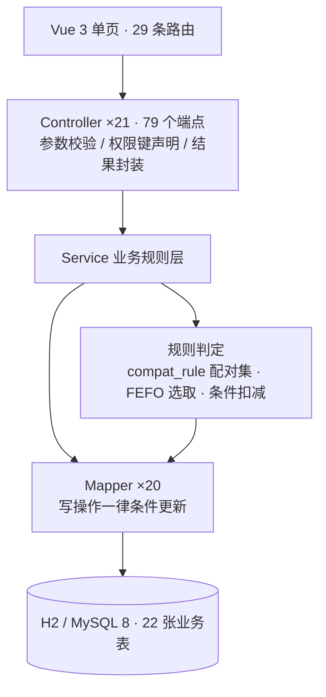

# hazmat-lims · 实验室危险化学品管理系统

实验室危化品从采购、入库、领用、退库到盘点的全流程管控。重点不在表单堆砌，而在**规则可判定**：
禁配能不能同柜、出库该扣哪一批、盘点差多少算平，全部由后端算出来并拒绝，而不是靠操作人自己牢记。

## 架构



一条写操作的基本形状：Service 先查规则表做判定，判定通过后转成一条带 `WHERE 状态=期望` 的 UPDATE，
用受影响行数当"成功/被并发抢先"的判据，最后在同一个事务里同时改批次余量与台账在库量。

## 三个不好糊弄的地方

### 一、禁配矩阵：必须双向有序对，必须禁止自反

`compat_rule(group_a, group_b)` 里一行只表达一个方向。判冲突时是把柜内在库批次的相容组与规则集做两两配对，
所以「酸 × 碱」和「碱 × 酸」都得存在——只写一条，另一方向就漏判，这属于规则数据本身的正确性问题，
不能靠查询语句去补。因此新增规则时成对写两行，删除时按双向条件一次删两行；两条写操作同事务，不会出现半对规则。

自反（`group_a = group_b`）在服务层直接拒绝。同组化学品同柜是常态，若允许自反规则，等于一条数据就能
让某类化学品全场无处可放，而且这种"规则把自己禁掉"的故障极难从日志里看出来。
`UNIQUE(group_a, group_b)` 只负责防重，禁自反是业务判定，两者分工不能混。

判定口径是**批次实际柜位**，不是台账期望柜位：一条化学品的各批次可能分散在多柜，只有真正在柜内的批次才参与配对。
另有一种化学品带两个相容组（主组 + 次组）的情形，任一命中即算冲突，避免"换个组就绕过去"。

### 二、FEFO：条件扣减，扣空了就换批

出库不是"选一批扣掉"，而是按效期先后排队逐批扣：

1. 先取候选批次（在库、有余量），按效期升序、批号次序排；
2. 用 `SUM(qty_left)` 做一次预检，总量不够直接拒绝，不做任何扣减；
3. 逐批执行 `UPDATE ... SET qty_left = qty_left - ? WHERE id = ? AND status = 0 AND qty_left >= ?`；
4. **受影响行数为 0 就 `continue` 换下一批**——这行没扣成（被别人抢先、或状态已变），本次需求量原样带到下一批；
5. 全部批次扣完仍有缺口则回滚整体；台账侧只扣一次总量，不按批扣。

第 4 步是这套写法与"先查再改"的分水岭。先查再改在并发下会写出负余量或丢扣减；
条件更新把"这一批还够不够"交给数据库判定，`affected=0` 不是异常，而是正常的换批信号。
单据状态 `1→2` 放在所有扣减与明细落库之后才推进，保证"出库中"的单据不可能只有半张明细。

### 三、账物守恒：Σ批次余量 ≡ 台账在库量

不变量只有一句：某化学品台账的 `stock_qty`（在库量）恒等于它所有 **在库批次**（`status=0`）的 `qty_left` 之和。
维护它的方式不是定期对账，而是让**每一条改库存的路径都同时改两边、都在同一事务里、都带条件**：
入库加批次并加台账、出库扣批次并扣台账、盘盈盘亏按差值同向修正两边、废弃处置扣台账；
过期封存的批次按口径已退出 Σ（不计入在库量），销账时只把余量清零，不再动台账。
任何一边的条件更新没命中，整个事务回滚，账面不会留下只改了半边的中间态。

盘点因此必须分两段：`finish` 只把当时的批次余量快照成账面数、记录实盘数与差值，**一行库存都不动**；
`adjust` 才按差值做增量修正（正加负减，绝不"直接设成实盘数"），且每条差异只能调一次。
调账前还要确认批次仍在库——结单到调账之间批次可能已被封存，此时对不在 Σ 里的批次做加减会直接破坏不变量，
所以这类差异行会被标注为需要重盘并拒绝调账。

## 快速开始

环境：JDK 17+、Maven 3.9+；数据库用自带 H2 或自备 MySQL 8。不需要任何私有仓库。

### 默认（内嵌 H2，一条命令）

```bash
cd server
mvn -q spring-boot:run          # 首次启动自动建表并注入演示数据，端口 8080
```

打开 `http://localhost:8080`，演示账号 `admin / admin123`（生产务必改）。数据落在 `server/data/` 下的 H2 文件库。

### MySQL 8

```bash
mysql -uroot -p -e "CREATE DATABASE hazmat DEFAULT CHARACTER SET utf8mb4"
# MySQL 8 不认 CREATE INDEX IF NOT EXISTS：先去掉该子句生成等价建表脚本
sed -E 's/^CREATE (UNIQUE )?INDEX IF NOT EXISTS/CREATE \1INDEX/' \
  server/src/main/resources/schema.sql > /tmp/schema-mysql.sql
mysql -uroot -p hazmat < /tmp/schema-mysql.sql
export MYSQL_HOST=127.0.0.1 MYSQL_PORT=3306 MYSQL_DATABASE=hazmat \
       MYSQL_USERNAME=root MYSQL_PASSWORD='***' MYSQL_INIT_MODE=never
mvn -q spring-boot:run -Dspring-boot.run.profiles=mysql
```

`MYSQL_INIT_MODE=never` 是关键：建表已手工完成，若仍让应用执行 `schema.sql`，会在建索引语句上直接失败。
Windows 无 `sed` 时用 PowerShell 做同样替换（脚本要存成无 BOM 的 UTF-8，否则 MySQL 客户端读首行会报错）：
`(Get-Content server\src\main\resources\schema.sql) -replace '^CREATE (UNIQUE )?INDEX IF NOT EXISTS','CREATE $1INDEX' | Set-Content -Encoding utf8 schema-mysql.sql`

### 前端

```bash
cd web && npm ci && npm run build
cp -r dist/. ../server/src/main/resources/static/    # 再启动后端即同源访问
# 开发模式：后端加 --server.port=8081，另开 npm run dev（5174，代理已指向 8081）
```

## 测试

```bash
cd server && mvn -q test        # 202 个单元测试，0 失败（JUnit 5 + Mockito）
cd e2e && npm i -D @playwright/test && npx playwright install chromium
npx playwright test             # 29 个 E2E（后端需先在 8081 就绪）
```

单测集中在规则本身：禁配的成对命中与自反拒绝、FEFO 跨批拆分与"扣空换批"、盘点两段分离、
改派的条件更新幂等、超量归还拦截。E2E 覆盖登录、申购四级审批、领用双签出库、盘点调账等主链路。

## 技术栈

| 层 | 选型 |
| --- | --- |
| 后端 | Spring Boot 4.0.3 / Java 17 / MyBatis（mybatis-spring-boot 4.0.1）/ Spring AOP |
| 数据库 | H2 2.x（MODE=MySQL，单文件库）或 MySQL 8.x |
| 前端 | Vue 3.5 / Vue Router 4 / Element Plus 2.9 / ECharts 6 / Three.js 0.186 / Vite 6 |

## 范围说明

只做实验室场景：台账（化学品档案）、批次（效期与余量）、柜位（分类存放）三层，配套申购审批、入库、
领用归还、废弃处置、盘点对账。**不覆盖 GHS 全量分类**：相容组是 7 个自定义分组（有机、易燃、酸、碱、
氧化剂、还原剂、通用），判的是"同柜互斥"，不做隔离/隔开/分离三种储存方式的距离计算，也不解析 SDS、
不按储量阈值分级。不含采购招标、财务结算、人员培训等外围模块。

## 许可

MIT，见 [LICENSE](LICENSE)。
