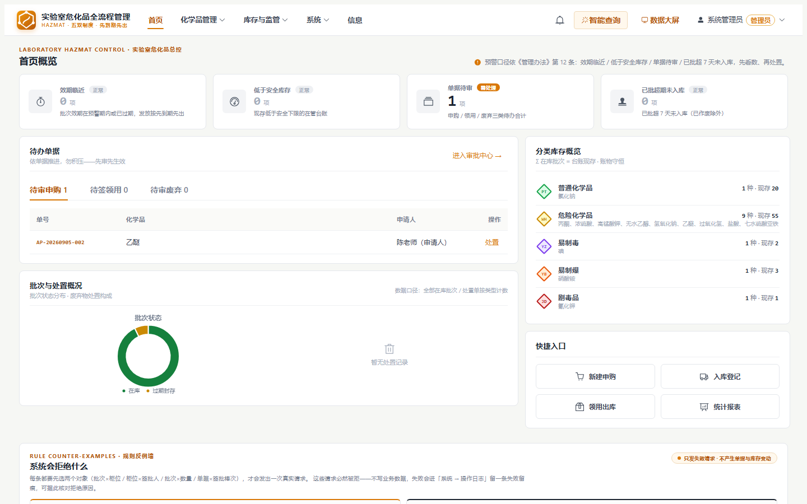
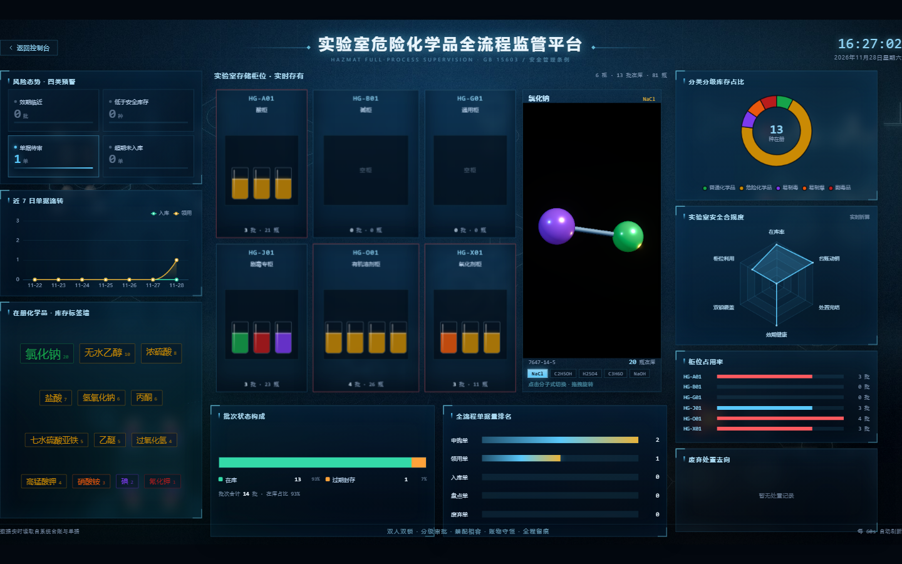

# hazmat-lims

高校实验室危险化学品全流程管理：申购审批 → 入库双签 → FEFO 领用 → 余量归还 → 废弃处置 → 盘点调账。禁配、先到期先出、账物守恒都写成后端可判定的规则。

| 登录页 | 看板 |
|---|---|
|  |  |

| 禁配规则墙 | 化学品台账 |
|---|---|
|  |  |

| 禁配规则维护 | 监管大屏 |
|---|---|
|  |  |

## 它解决什么问题

实验室危险化学品管理的难点在判定：同一柜里哪些能放、先出哪一批、账面与实物对不对得上。分散的登记表很难回答这三个问题，出了问题也追不到人。

系统覆盖台账、批次、柜位三层数据，把申购审批、入库双签、领用归还、废弃处置、盘点对账串成一条主流程。禁配冲突、剧毒单次上限、超领、超量归还、盘亏调账都在服务层拒绝并返回业务码，不靠操作人自觉。

每次成功或失败的操作都留日志，并记录所属业务模块，事后可按单据、按人、按时间回溯。

## 快速开始

环境：JDK 17+、Maven 3.9+、Node 18+。数据库用自带 H2，不需要预装。

一键启动：

```bash
# 仓库根目录；Windows 用 Git Bash
bash start.sh
```

脚本依次构建前端、把产物拷进后端静态目录、打包、后台启动并轮询 `/health`。就绪后打开 `http://localhost:8080`。

分步启动：

```bash
cd web && npm ci && npm run build
mkdir -p ../server/src/main/resources/static && cp -r dist/. ../server/src/main/resources/static/
cd ../server && mvn -q spring-boot:run          # 端口 8080
```

前端产物必须先进入 `classpath:/static`，只跑 `mvn package` 后访问 `GET /` 会返回 404 提示先构建前端。只调 API 时跳过前端即可，`/health` 与接口不受影响。

演示账号：`admin / admin123`（管理员）；`zhang`（导师）、`li`（安全员）、`wang`（学院）、`zhao`（校级）、`chen` 与 `liu`（申请人）口令 `123456`。两组口令可分别用 `APP_SEED_ADMIN_PASSWORD`、`APP_SEED_DEMO_PASSWORD` 覆盖，只在首次建库时生效。

数据落在 `server/data/` 下的 H2 文件库，停服后删掉该目录即可重置演示数据。

## 功能

| 模块 | 能力 |
|---|---|
| 化学品台账 | 档案、相容组（主组加次组）、GHS 标识、效期预警天数、安全库存、封存与解封 |
| 批次 | 效期与余量、柜位、移柜、过期标记 |
| 申购 | 草稿 → 按分类走 1 到 4 级审批 → 已批；驳回、作废、审批流转留痕 |
| 入库 | 一步签收或双签复核，登记人不能自任第二签 |
| 领用与归还 | 导师签 → 复核双签 → FEFO 出库；余量归还回原批、改派、核销 |
| 废弃处置 | 废液处置去向、审批销账 |
| 盘点 | `finish` 只快照账面差异，`adjust` 才按差值调账，每条差异只能调一次 |
| 待办中心 | 待审申购、待签领用、归还确认三个入口 |
| 基础数据与系统 | 字典、用户、角色、菜单、操作日志、站内信 |
| 智能查询 | 缓存回放、台账检索、法规条文检索；无密钥时自动降级，不编造数据 |

前端 28 条路由，后端 80 个 API 端点，由 21 个 Controller 与 20 个 MyBatis Mapper 实现。

## 设计要点

完整论证与实现约束见 [docs/DESIGN.md](docs/DESIGN.md)。

### 禁配矩阵

`compat_rule(group_a, group_b)` 成对写入两行，判定时把两端字符串排序后拼接成配对键，一条规则同时覆盖两个查询方向。自反规则（同组相禁）在服务层拒绝，否则一条数据就能让某类化学品全场无处可放；判定只看批次实际柜位，主组、次组任一命中即算冲突。

### FEFO

候选批次按效期升序排队逐批扣，够不够扣交给数据库判断：条件更新命中即扣，未命中就换下一批，本次需求量原样带走。全部批次扣完仍有缺口则整单回滚；过期批次在 SQL 层排除，没有失效日期的批次照常参与出库。

### 账物守恒

台账 `stock_qty` 恒等于所有在库批次 `qty_left` 之和。改库存的每条路径都同时改两边、在同一事务里、带状态条件，任一边没命中就回滚。盘点分两段：`finish` 只快照账面差异，`adjust` 才按差值调账，每条差异只能调一次，避免把实盘数直接写成账面数。

### 令牌生命周期

`LoginInterceptor` 每次请求回查账号状态，停用、改密、管理员重置口令、登出立即失效，重新启用后旧令牌仍然无效。未配置 `APP_TOKEN_SECRET` 时签名密钥每次启动重新生成，重启即全部失效。

## 测试

```bash
cd server && mvn -B -o test      # 216 条单测，22 个测试类，离线可跑
cd e2e && npx playwright test    # 29 条端到端，单 worker 串行
```

E2E 需要后端在 8080 上同时提供页面与 API、`web/dist/` 已构建、Chromium 已安装。用例共用同一份演示库，串行执行避免批次余量断言相互干扰。

## 部署

演示口令与临时令牌密钥只适合本地演示，对外提供服务前覆盖默认值：

| 环境变量 | 作用 |
|---|---|
| `APP_SEED_ADMIN_PASSWORD` | 种子管理员初始口令 |
| `APP_SEED_DEMO_PASSWORD` | 其余演示账号初始口令 |
| `APP_TOKEN_SECRET` | 令牌签名密钥，未设置则每次启动随机生成 |
| `APP_SECURITY_TRUST_PROXY` | 是否信任反向代理写入的 `X-Forwarded-For` |
| `APP_SECURITY_TRUSTED_PROXIES` | 受信反向代理地址清单 |
| `DEEPSEEK_API_KEY` | AI 问答模型凭据，缺省时 AI 层自动降级 |

```bash
docker build -t hazmat-management:1.0.0 .
docker run -d --name hazmat -p 8080:8080 -v hazmat-data:/app/data hazmat-management:1.0.0
```

改用 MySQL 8 时 schema 需要先转换，完整说明见 [docs/DESIGN.md](docs/DESIGN.md) 第 8 节。

## 已知边界

- MySQL 8 只在本机单实例验证过，5.7、托管实例、主从复制与跨时区部署都不在验证范围内。
- 不覆盖 GHS 全量分类：7 个自定义相容组只判同柜互斥，不做储存方式距离计算，不解析 SDS，不含采购招标、财务结算、人员培训。
- 过期封存（批次 `status=3`）在默认流程不可达，type=3 废弃单需要人工置状态；账物守恒是设计约定与守卫，没有周期性断言校验。
- H2 是单文件库，同一库不能被两个进程同时打开，并行验证与 E2E 用独立库路径。
- 单据状态、业务码与接口约定以 [docs/api.md](docs/api.md) 为准，改接口必须同步改文档。

## 技术栈

Spring Boot 4.0.3 / Java 17 / MyBatis / H2 2.x 或 MySQL 8 / Vue 3.5 / Element Plus / ECharts / Three.js / Vite 6。

## 目录结构

```text
hazmat-lims/
├── server/                  Spring Boot 后端（Java 17）
│   ├── src/main/java/       web/ 控制器 21 个 · service/ 业务规则 · mapper/ 数据访问 · security/ 令牌与拦截
│   ├── src/main/resources/  mapper/*.xml · schema.sql · db/migration/（V1 基线 + V2 站内信）
│   ├── src/test/java/       22 个测试类、216 条单测（H2 内存库 + mock）
│   └── 数据层                 23 张业务表 + schema_version，共 24 张
├── web/                     Vue 3 前端（Vite），28 条路由
│   └── src/views/           台账/申购/入库/领用/废弃/盘点/大屏/打印/系统管理
├── e2e/                     Playwright 端到端 29 条
│   ├── tests/               accept（A01-A16）/ extra / review（R01-R07）/ ai
│   └── scripts/screenshots.js 截图生成脚本
├── docs/                    DESIGN.md 设计说明 · api.md 接口清单 · screenshots/ 截图
├── scripts/                 本地辅助脚本
├── tools/convert_schema.py  H2 建表脚本 → MySQL 8 语法转换
├── start.sh                 一键构建与启动
├── Dockerfile               多阶段自包含镜像
└── .github/workflows/ci.yml 后端单测 / 前端构建 / E2E
```

## 许可

MIT，见 [LICENSE](LICENSE)。
