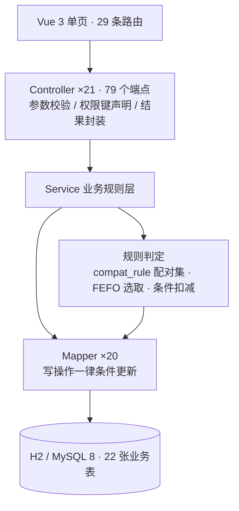

# hazmat-lims · 实验室危险化学品管理系统

实验室危化品从采购、入库、领用、退库到盘点的全流程管控。重点不在表单堆砌，而在**规则可判定**：
禁配能不能同柜、出库该扣哪一批、盘点差多少算平，全部由后端算出来并拒绝，而不是靠操作人自己牢记。

## 架构



一条写操作的基本形状：Service 先查规则表做判定，判定通过后转成一条带 `WHERE 状态=期望` 的 UPDATE，
用受影响行数当"成功/被并发抢先"的判据，最后在同一个事务里同时改批次余量与台账在库量。

## 三个不好糊弄的地方

### 一、禁配矩阵：必须双向有序对，必须禁止自反

`compat_rule(group_a, group_b)` 里一行只表达一个方向。判冲突时是把柜内在库批次的相容组与规则集做两两配对，
所以「酸 × 碱」和「碱 × 酸」都得存在——只写一条，另一方向就漏判，这属于规则数据本身的正确性问题，
不能靠查询语句去补。因此新增规则时成对写两行，删除时按双向条件一次删两行；两条写操作同事务，不会出现半对规则。

自反（`group_a = group_b`）在服务层直接拒绝。同组化学品同柜是常态，若允许自反规则，等于一条数据就能
让某类化学品全场无处可放，而且这种"规则把自己禁掉"的故障极难从日志里看出来。
`UNIQUE(group_a, group_b)` 只负责防重，禁自反是业务判定，两者分工不能混。

判定口径是**批次实际柜位**，不是台账期望柜位：一条化学品的各批次可能分散在多柜，只有真正在柜内的批次才参与配对。
另有一种化学品带两个相容组（主组 + 次组）的情形，任一命中即算冲突，避免"换个组就绕过去"。

### 二、FEFO：条件扣减，扣空了就换批

出库不是"选一批扣掉"，而是按效期先后排队逐批扣：

1. 先取候选批次（在库、有余量），按效期升序、批号次序排；
2. 用 `SUM(qty_left)` 做一次预检，总量不够直接拒绝，不做任何扣减；
3. 逐批执行 `UPDATE ... SET qty_left = qty_left - ? WHERE id = ? AND status = 0 AND qty_left >= ?`；
4. **受影响行数为 0 就 `continue` 换下一批**——这行没扣成（被别人抢先、或状态已变），本次需求量原样带到下一批；
5. 全部批次扣完仍有缺口则回滚整体；台账侧只扣一次总量，不按批扣。

第 4 步是这套写法与"先查再改"的分水岭。先查再改在并发下会写出负余量或丢扣减；
条件更新把"这一批还够不够"交给数据库判定，`affected=0` 不是异常，而是正常的换批信号。
单据状态 `1→2` 放在所有扣减与明细落库之后才推进，保证"出库中"的单据不可能只有半张明细。

### 三、账物守恒：Σ批次余量 ≡ 台账在库量

不变量只有一句：某化学品台账的 `stock_qty`（在库量）恒等于它所有 **在库批次**（`status=0`）的 `qty_left` 之和。
维护它的方式不是定期对账，而是让**每一条改库存的路径都同时改两边、都在同一事务里、都带条件**：
入库加批次并加台账、出库扣批次并扣台账、盘盈盘亏按差值同向修正两边、废弃处置扣台账；
过期封存的批次按口径已退出 Σ（不计入在库量），销账时只把余量清零，不再动台账。
任何一边的条件更新没命中，整个事务回滚，账面不会留下只改了半边的中间态。

盘点因此必须分两段：`finish` 只把当时的批次余量快照成账面数、记录实盘数与差值，**一行库存都不动**；
`adjust` 才按差值做增量修正（正加负减，绝不"直接设成实盘数"），且每条差异只能调一次。
调账前还要确认批次仍在库——结单到调账之间批次可能已被封存，此时对不在 Σ 里的批次做加减会直接破坏不变量，
所以这类差异行会被标注为需要重盘并拒绝调账。

## 快速开始

环境：JDK 17+、Maven 3.9+；数据库用自带 H2 或自备 MySQL 8.0.x（本轮实测 8.0.45）。不需要任何私有仓库。

### 默认（内嵌 H2，一条命令）

```bash
cd server
mvn -q spring-boot:run          # 首次启动自动建表并注入演示数据，端口 8080
curl http://localhost:8080/health
```

打开 `http://localhost:8080`，演示账号 `admin / admin123`（生产务必改，或启动前设 `APP_SEED_ADMIN_PASSWORD` 覆盖）。
数据落在 `server/data/` 下的 H2 文件库。

**实测（2026-11-27，Windows / JDK 21.0.8 / Maven 3.9.9）**：

```text
$ cd server && mvn -o spring-boot:run
$ curl http://localhost:8080/health
HTTP 200
{"status":"UP","version":"1.0.0","time":"2026-11-27 14:37:37",
 "checks":{"db":"up","regs":"up(128)","ai":"degraded(no-key)"}}
```

`db=up` 表示 H2 建表 + 种子数据就绪；`regs=up(128)` 是加载到的法规条目数；
`ai=degraded(no-key)` 是**预期状态**——没配 `DEEPSEEK_API_KEY` 时 AI 层自动降级，
不影响主流程。想从头再来一遍：停服后删掉 `server/data/` 再启动。

### MySQL 8

实测版本 8.0.45（Community Server）。库名、口令、端口一律走环境变量，命令里不出现真实口令。
下面四条都在**仓库根目录**执行（注意 `cd server` 只在最后一步）。

```bash
# 1) 建库。不写 COLLATE 就用 MySQL 8 默认的 utf8mb4_0900_ai_ci，实测可用
mysql -uroot -p --default-character-set=utf8mb4 \
  -e "CREATE DATABASE hazmat DEFAULT CHARACTER SET utf8mb4"

# 2) 生成 MySQL 版建表脚本：MySQL 8 不认 CREATE INDEX IF NOT EXISTS
sed -E 's/^CREATE (UNIQUE )?INDEX IF NOT EXISTS/CREATE \1INDEX/' \
  server/src/main/resources/schema.sql > /tmp/schema-mysql.sql

# 3) 导入（转换后 22 张表 / 44 个索引，exit 0）
mysql -uroot -p --default-character-set=utf8mb4 hazmat < /tmp/schema-mysql.sql

# 4) 启动。建表已手工完成，初始化模式必须改成 never
export MYSQL_HOST=127.0.0.1 MYSQL_PORT=3306 MYSQL_DATABASE=hazmat \
       MYSQL_USERNAME=hazmat MYSQL_PASSWORD='***' MYSQL_INIT_MODE=never
cd server && mvn -q spring-boot:run -Dspring-boot.run.profiles=mysql
```

跳过第 2 步直接导入，第 32 行第一条 `CREATE UNIQUE INDEX IF NOT EXISTS` 就报
`ERROR 1064 (42000)`；mysql 客户端在批处理模式下随即中止，22 张表里只建成 1 张。
`MYSQL_INIT_MODE` 留在默认 `always` 时，应用启动会在同一条语句上失败
（`Failed to execute SQL script statement #2 of file [...schema.sql]`），所以必须显式设 `never`。

Windows 没有 `sed` 时用 PowerShell 做同样替换。两个坑：`Get-Content` 默认按 ANSI 解码，
必须先加 `-Encoding UTF8`，否则脚本里的中文注释会乱码；`Set-Content -Encoding utf8`
在 PowerShell 5.1 下写出的是带 BOM 的 UTF-8。实测 8.0.45 的客户端能吞掉 BOM，
但不保证换版本还如此，稳妥写法是直接写无 BOM：

```powershell
$lines = Get-Content -Path server\src\main\resources\schema.sql -Encoding UTF8
$utf8NoBom = New-Object System.Text.UTF8Encoding $false
[System.IO.File]::WriteAllLines('schema-mysql.sql',
  ($lines -replace '^CREATE (UNIQUE )?INDEX IF NOT EXISTS','CREATE $1INDEX'), $utf8NoBom)
```

`-replace` 要作用在逐行数组上，`^` 才锚得住行首；若对整段文本替换，正则需加 `(?m)`。

**MySQL 分支实测（2026-11-27，Windows / JDK 21.0.8 / Maven 3.9.9）**：

```text
MySQL 8.0.45 免安装实例：mysqld --initialize-insecure（root 空口令），独立 datadir
端口 3307（本机 3306 已被既有实例占用），character-set-server=utf8mb4，default-time-zone=+08:00
库 hazmat（默认 utf8mb4_0900_ai_ci）

原始 schema.sql 导入 → exit 1
  ERROR 1064 (42000) at line 32: ... near 'IF NOT EXISTS uk_chem_code ON chem_info(code)'
  （在第一条索引处中止，只建成 1 张表）
转换后导入 → exit 0，22 张表 / 44 个索引
MYSQL_INIT_MODE=always → 启动失败（statement #2 同一条索引语句），exit 1
MYSQL_INIT_MODE=never  → GET /health 200
  {"status":"UP","version":"1.0.0","checks":{"db":"up","regs":"up(128)","ai":"degraded(no-key)"}}
```

管理员登录 `code:0`；`/chem/stats/dashboard`、`/chem/stats/ledger`、`/chem/info/list`
等只读接口全部 `code:0`；申购单创建 → 提交 → 审批中写链路成功；中文按 UTF-8 存取一致
（`HEX('无水乙醇')` = `E697A0E6B0B4E4B999E98687`，与 Java 写入值逐字节相同）；
`mvn -q test` 在 MySQL profile 改动后仍是 202 条全过。

### 前端

```bash
cd web && npm ci && npm run build
mkdir -p ../server/src/main/resources/static && cp -r dist/. ../server/src/main/resources/static/   # 再启动后端即同源访问
# 开发模式：后端加 --server.port=8081，另开 npm run dev（5174，代理已指向 8081）
```

## 测试

2026-11-27 在本机实测（Windows / JDK 21.0.8 / Maven 3.9.9 / Node 22.20.0）：

| 项 | 命令 | 实测结果 |
|---|---|---|
| 后端单测 | `cd server && mvn -q test` | **Tests run: 202, Failures: 0, Errors: 0, Skipped: 0**（17 个测试类，`-o` 离线可跑） |
| 前端依赖 | `cd web && npm ci` | `added 126 packages in 36s`（首次需联网） |
| 前端构建 | `cd web && npm run build` | **vite 6.4.3，2349 modules transformed，29.92 s**；`dist/index.html` 1.90 kB、CSS 427.77 kB、JS 3 377.62 kB（gzip 1 066.31 kB）；只有「chunk 大于 500 kB」提示 |
| E2E | `cd e2e && npx playwright test` | **29 passed（1.2 m，4 workers）** |

E2E 要求**后端在 8081 上同时提供前端页面与 API**。先把 `dist/` 交给后端同源提供，再起服务：

```bash
cd web && npm run build

# 方式 A：拷进静态目录后重新打包（上面的标准路径）
mkdir -p ../server/src/main/resources/static && cp -r dist/. ../server/src/main/resources/static/

# 方式 B：不重新打包，启动时把静态目录指过去（本轮实测用的这条）
cd ../server && java -jar target/hazmat-management-1.0.0.jar --server.port=8081 \
  --spring.web.resources.static-locations=file:///E:/github/publish/hazmat-lims/web/dist/ \
  --spring.datasource.url='jdbc:h2:file:./data/e2e-hazmat;MODE=MySQL;CASE_INSENSITIVE_IDENTIFIERS=TRUE'

# 首次需要浏览器二进制（约 124 MB）；缺了 29 条会全部报 Executable doesn't exist
cd ../e2e && npm ci && npx playwright install chromium
BASE_URL=http://localhost:8081 npx playwright test
```

单测集中在规则本身：禁配的成对命中与自反拒绝、FEFO 跨批拆分与"扣空换批"、盘点两段分离、
改派的条件更新幂等、超量归还拦截。E2E 覆盖登录、申购审批链、领用双签出库、盘点调账等主链路。

## 技术栈

| 层 | 选型 |
| --- | --- |
| 后端 | Spring Boot 4.0.3 / Java 17 / MyBatis（mybatis-spring-boot 4.0.1）/ Spring AOP |
| 数据库 | H2 2.x（MODE=MySQL，单文件库）或 MySQL 8.x |
| 前端 | Vue 3.5 / Vue Router 4 / Element Plus 2.9 / ECharts 6 / Three.js 0.186 / Vite 6 |

## 已知限制

- **MySQL 8 分支已完整实测，范围仅限本机单实例。** 2026-11-27 用 8.0.45 免安装实例
  （端口 3307、独立 datadir）把 README 的四步跑通：原始 `schema.sql` 在 line 32 第一条
  `CREATE INDEX IF NOT EXISTS` 上报 `ERROR 1064` 并中止（只建成 1 张表）；转换脚本改写
  24 条索引语句后导入成功（22 表 / 44 索引）；`MYSQL_INIT_MODE=never` 启动后 `/health` 为
  UP、`db=up`，登录、看板、申购写链路都正常，中文按 UTF-8 存取一致；
  `MYSQL_INIT_MODE=always` 的对照启动如实失败。未覆盖：MySQL 5.7、DBA 托管的库、
  主从复制、跨时区实例与生产参数调优。
- **预警查询不再使用 H2 专属函数。** 看板的效期预警与「已批超期未入库」原用三参数
  `DATEDIFF('DAY', a, b)`，MySQL 的 `DATEDIFF` 只接两个参数，MySQL 下
  `/chem/stats/dashboard` 会直接 500。现统一为 `TIMESTAMPDIFF(DAY, a, b)`（H2 2.x 与
  MySQL 8 语义一致），后者再加 `CAST(audit_time AS DATE)` 保持「按自然日」的原口径。
  新增 SQL 时应沿用这条：只用两库都有的函数，避免 `DATEDIFF` 三参、`FORMATDATETIME`
  这类 H2 专有写法。
- **E2E 不是一条 `npm test` 就能跑。** 它依赖三件环境：① 后端在 8081 提供同源页面与 API；
  ② `web/dist/` 已构建；③ Playwright 浏览器已安装。缺任何一件时，失败信息都容易误读成业务失败
  —— 尤其缺浏览器时报 `Executable doesn't exist at ...chromium_headless_shell-1255`。
- **H2 是单文件库，同一库不能被两个进程同时打开。** 做 E2E 或并行验证时请用独立库路径
  （如上文的 `./data/e2e-hazmat`），否则第二个实例会在启动时锁失败。
- **`spring.sql.init.mode` 默认 `always`。** 每次启动都会执行 `schema.sql`（全部
  `IF NOT EXISTS`，幂等）；MySQL 生产库若已由 DBA 建好，必须设 `MYSQL_INIT_MODE=never`，
  否则会在建索引语句上失败。
- **口令与密钥是演示值。** 演示口令默认值仅用于本地演示，可通过 `APP_SEED_ADMIN_PASSWORD` 覆盖：
  设置后种子里 admin 的初始口令就是它，未设置则回落到 `admin/admin123`（开箱即用）；
  两种情况下启动日志都不回显口令本体，用默认值时打印一行警告。
  `APP_TOKEN_SECRET` 未设置时回落到
  开发默认值（生产务必显式设置）。`DEEPSEEK_API_KEY` 未设置时 `/health` 显示
  `ai=degraded(no-key)`，AI 问答降级为规则路径，不影响业务主流程。
- **不覆盖 GHS 全量分类**（见「范围说明」）：只有 7 个自定义相容组，判"同柜互斥"，
  不做隔离/隔开/分离的距离计算，不解析 SDS、不按储量阈值分级。
- **本轮环境事实**：本机 Maven 3.9.9 未加入 `PATH`，单测与 `spring-boot:run` 是用临时解压的
  Maven 二进制跑的；README 里的命令本身未改。

## 范围说明

只做实验室场景：台账（化学品档案）、批次（效期与余量）、柜位（分类存放）三层，配套申购审批、入库、
领用归还、废弃处置、盘点对账。**不覆盖 GHS 全量分类**：相容组是 7 个自定义分组（有机、易燃、酸、碱、
氧化剂、还原剂、通用），判的是"同柜互斥"，不做隔离/隔开/分离三种储存方式的距离计算，也不解析 SDS、
不按储量阈值分级。不含采购招标、财务结算、人员培训等外围模块。

## 许可

MIT，见 [LICENSE](LICENSE)。
